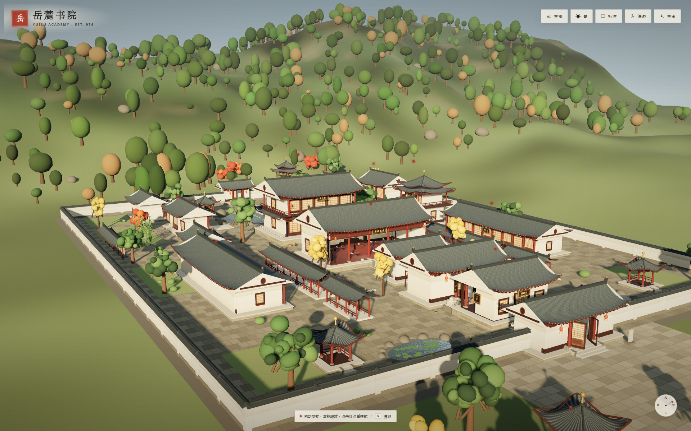

# 岳麓书院 · 可探索的 3D 模型

一座可以直接在浏览器里漫游的岳麓书院三维复原场景。中轴对称的赫曦台、大门、二门、讲堂、御书楼，南北斋舍、文昌阁、文庙、后园与院外爱晚亭，均以低多边形写意方式重建。场景刻意不放置人物，以空院、书案、茶器、古琴、香炉、礼器、盆栽与荷池来保留细节和留白；暖调侧光、柔和阴影、暗角与轻微胶片颗粒让它更接近一支安静的建筑短片。不依赖任何在线资源，双击 `index.html` 即可打开。



## 快速开始

- **直接打开**：双击 `index.html`（推荐 Chrome / Edge）。
- **本地服务**（可选，便于调试）：

  ```powershell
  cd yuelu-academy-3d
  python -m http.server 8765
  # 打开 http://127.0.0.1:8765/
  ```

首次进入会看到一段从山门方向推近的镜头。场景完全离线，Three.js 已放在 `vendor/` 中。

项目是纯静态前端，不需要 Node、后端或数据库；`vendor/` 内已包含运行所需的 Three.js 文件。

## 可以做什么

- **电影式漫游**：默认使用低角度全景镜头，中央院落与屋面层层展开；暖色侧光、柔和阴影、暗角和轻微颗粒让画面更接近电影静帧。
- **极简标记**：场景中只保留小红点，鼠标悬停才显示建筑名；点击红点即可查看介绍。按 `L` 或点击“标注”可展开全部名称。
- **第一人称漫游**：点击“漫游”或按 `V`，以 `W A S D` 在中轴院落、斋舍、后园和爱晚亭之间行走，鼠标环视，`Shift` 加速，`Esc` 退出。前门、大门、二门的中央门道可以穿行。
- **走进建筑**：讲堂、御书楼、百泉轩都可以从门洞/前阶进入室内；走到台基前会自动抬升视点，室内有书案、书架、烛台、茶器、山水画与宫灯可看。
- **移动端**：手机/平板进入漫游后会出现左侧虚拟摇杆，拖动画面环视；桌面端仍使用键鼠。
- **昼夜切换**：点击“昼 / 夜”或按 `N`。夜间窗棂、灯笼与庭院点灯，山体退入深蓝，灯光带柔和光晕。
- **导览路线**：12 个站点按“中轴—两厢—园林—院外”组织，点击即可飞行定位。
- **GLB 导出**：点击“导出”会下载 `yuelu-academy.glb`，可在 Blender、Unity、Unreal 等软件中继续编辑。仓库内已附一份导出的 GLB。
- **无人场景**：人物全部移除，保留书案、茶席、古琴、香炉、礼器与荷池等陈设，让建筑与光影成为主角。

## 模型范围

| 分区 | 主要建筑 |
| --- | --- |
| 中轴 | 前门、赫曦台、大门、二门、讲堂、御书楼 |
| 两厢 | 教学斋、半学斋、文昌阁、濂溪祠、文庙（大成殿） |
| 园林 | 百泉轩、汲泉亭、拟兰亭、屈子祠、船山祠、荷池、石桥、碑廊 |
| 院外 | 自卑亭、爱晚亭、清风峡小径 |

场景尺度约为 **1 单位 = 1 米**，书院主体约 104 × 138 米。建筑形制、院落比例与匾额位置参考公开资料做了写意复原；**这不是测绘级模型**，细部尺寸、屋面曲线与植物配置均为艺术化处理。

## 文件说明

```
yuelu-academy-3d/
├─ index.html              页面入口
├─ css/style.css           界面样式
├─ js/
│  ├─ utils.js             程序化纹理、材质、曲面屋顶等基础工具
│  ├─ architecture.js      殿堂、门、亭、斋舍等建筑构件
│  ├─ furnishings.js       书案、茶器、古琴、香炉、礼器、盆栽等陈设
│  ├─ scene.js             总平面、山水、植物、灯光、导览数据
│  └─ app.js               渲染循环、交互、第一人称、GLB 导出
├─ yuelu-academy.glb       导出的 GLB 模型（约 38.1 MB）
├─ screenshots/            场景截图（含可进入的室内视图）
└─ vendor/                 离线运行所需的 Three.js、OrbitControls、GLTFExporter 及许可证
```

## 技术说明

- 纯原生 JavaScript + Three.js r128，无打包步骤。
- 屋顶为参数化曲面 BufferGeometry；瓦垄、石阶、木纹、窗棂、匾额文字均为 Canvas 程序化纹理。
- 场景约 **42 万三角面**；远景森林使用 InstancedMesh，建筑内部陈设按材质合并。
- 主要材质使用 1024 级程序化纹理与凹凸贴图；水面由法线贴图、天空环境反射和缓慢偏移的波纹组成。
- 树冠使用顶点着色器风吹动画，并有 150 片飘落树叶；灯笼带动态光晕，夜间更明显。
- 导出的 GLB 约 38.1 MB、1068 个网格、27.9 万三角面、39 张贴图；实例化瓦当、灯笼光晕与水面环境反射在导出时自动排除。
- 支持 `?nointro=1`（跳过加载动画）、`?view=hero|aerial|gate|garden|aiwan|interior`、`?night=1`、`?ui=0` 等 URL 参数，便于截图或嵌入。

## 快捷键

| 按键 | 作用 |
| --- | --- |
| `V` | 进入 / 退出漫游 |
| `W A S D` / 方向键 | 漫游移动 |
| `Shift` | 加速 |
| 移动端左摇杆 | 漫游移动 |
| 移动端拖动画面 | 环视 |
| `N` | 昼夜切换 |
| `L` | 标注开关 |
| `R` | 导览面板 |
| `Esc` | 退出漫游 |

## 资料参考

- 湖南省人民政府门户网站《岳麓书院》：<https://www.hunan.gov.cn/hnszf/c101474/202108/t20210827_20403698.html>
- 湖南大学岳麓书院“导览地图”与推荐参观路线：<https://ylsy.hnu.edu.cn/wbly/cgdn/dld_.htm>
- 华声在线《岳麓书院》关于“坐西朝东、中轴对称、北侧半学斋、南侧教学斋”的概述：<http://travel.voc.com.cn/news/201701/28002937.html>
- 人民日报海外版《岳麓书院是什么样的建筑？》关于讲堂、藏书、祭祀三大功能的介绍。

## 说明

本项目用于学习、展示与空间叙事实验。匾额文字、院落关系与主要建筑位置力求贴近公开资料，但模型并非文物测绘成果；如需用于出版、复原研究或工程用途，请以测绘与文保资料为准。

Three.js 以 MIT 协议分发，许可证见 `vendor/THREE-LICENSE.txt`。界面字体使用系统自带的宋体 / 楷体 / 微软雅黑，不额外加载网络字体。
